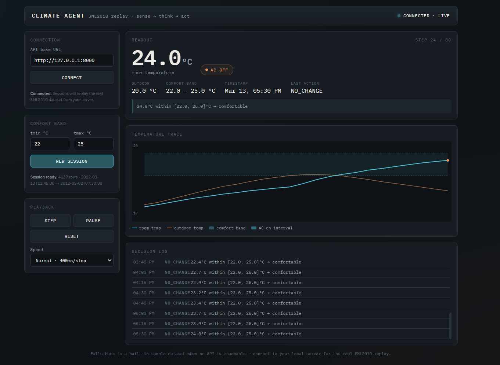

# Climate Agent

A smart home temperature control agent that monitors room temperature and
automatically switches air conditioning on/off to maintain a comfortable
range — replayed against **real sensor data** (the [SML2010](http://archive.ics.uci.edu/dataset/274/sml2010)
indoor climate dataset) instead of synthetic physics.



## The experiment

The agent follows a simple **sense → think → act** loop:

1. **Sense** — read the current room temperature from a real historical sensor reading.
2. **Think** — compare it against a comfort band `[tmin, tmax]` using a pure decision
   function with hysteresis, so the AC doesn't flicker rapidly at the boundary:
   - temp **above** `tmax` and AC is off → turn AC **on**
   - temp **at or below** `tmin` and AC is on → turn AC **off**
   - otherwise → no change
3. **Act** — apply the decision, log it (including a human-readable "thought"), and move
   to the next reading.

Rather than simulating temperature with made-up physics, the agent steps through actual
SML2010 sensor logs row by row, so the decisions you see are driven by real recorded
indoor/outdoor temperatures.

The system has two parts:

- **`app/`** — a FastAPI backend that loads the dataset, runs the agent, and exposes a
  session-based replay API.
- **`static/climate-agent.html`** — a dashboard that connects to the API, steps or plays
  through the replay, and visualizes the temperature trace, AC state, and the agent's
  reasoning log in real time.

## Project structure

```
climate-agent/
├── pyproject.toml
├── static/
│   └── climate-agent.html      # dashboard UI, served by FastAPI
├── data/
│   ├── raw/
│   │   ├── NEW-DATA-1.T15.txt
│   │   └── NEW-DATA-2.T15.txt
│   └── processed/
│       └── sml2010.parquet     # cached parsed dataset, generated on first run
├── app/
│   ├── main.py                 # FastAPI app, routes, static mount
│   ├── config.py                # paths, default thresholds
│   ├── data_loader.py           # parses raw txt -> DataFrame, caches parquet
│   ├── agent.py                 # pure sense/think/act decision function
│   ├── simulator.py             # replays dataset rows through the agent
│   ├── models.py                 # Pydantic request/response schemas
│   └── state.py                  # in-memory session store
├── tests/
│   ├── test_data_loader.py
│   ├── test_agent.py
│   └── test_simulator.py
└── README.md
```

## Install uv

If you don't already have [`uv`](https://docs.astral.sh/uv/) installed:

```bash
# macOS / Linux
curl -LsSf https://astral.sh/uv/install.sh | sh

# Windows (PowerShell)
powershell -ExecutionPolicy ByPass -c "irm https://astral.sh/uv/install.ps1 | iex"
```

## Run it

> **Important:** run these commands from inside the `climate-agent/` directory —
> the static file mount and data paths are resolved relative to where you launch it.

```bash
uv sync
uv run fastapi dev app/main.py
```

Then open the dashboard:

```
http://127.0.0.1:8000/ui/climate-agent.html
```

In the dashboard:

1. Click **Connect** (defaults to `http://127.0.0.1:8000`) to confirm the API is reachable.
2. Set your comfort band (`tmin` / `tmax`) and click **New session**.
3. Use **Step** to advance one reading at a time, or **Play** to auto-step at a chosen
   speed. **Reset** returns to the start of the dataset.
4. Watch the trace, the AC on/off badge, and the decision log update as the agent works
   through the real sensor history.

You can also drive the API directly via the auto-generated docs at
`http://127.0.0.1:8000/docs`.

## Notes

- Session state is stored **in memory** (a plain dict keyed by session id) — it resets
  whenever the server restarts, and isn't shared across multiple worker processes. Fine
  for this prototype; swap for Redis or a DB-backed store if that changes.
- `room_temp` is sourced from `Temperature_Habitacion_Sensor` (the bedroom/room sensor)
  in the raw dataset; `Temperature_Comedor_Sensor` (dining room) is the other candidate
  column if you'd rather track that room instead.
- The dashboard falls back to a small built-in synthetic sample if it can't reach the
  API, so the UI can be previewed without the backend running — but real experiment
  results always come from the live SML2010 replay.
